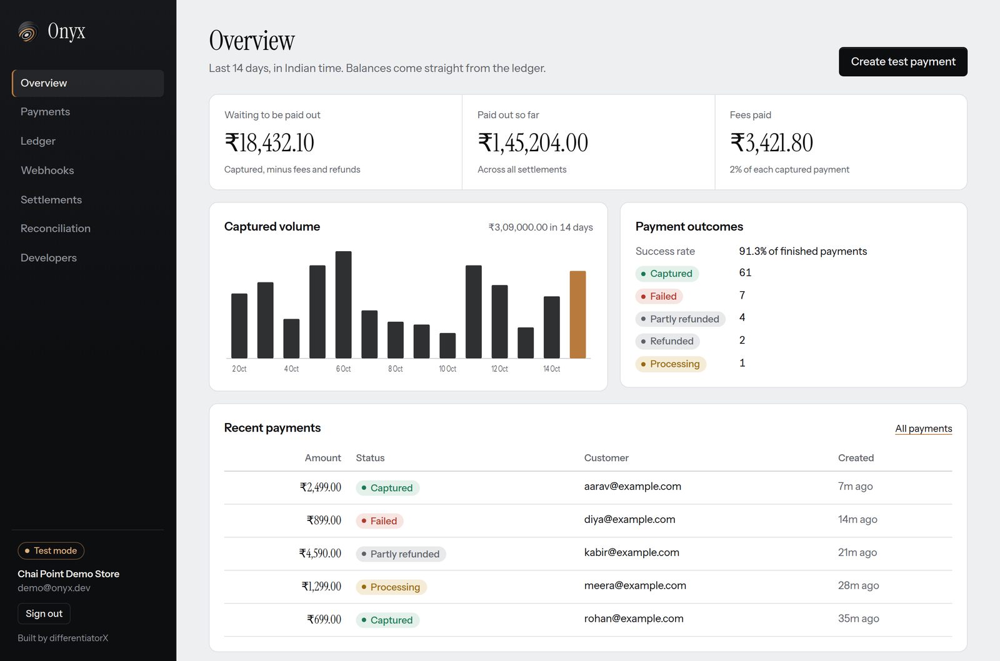
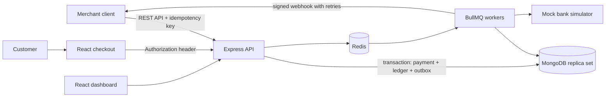

# PayOps

**A simulated payment operations and reliability project for learning how payment systems handle retries, failures, refunds, and asynchronous events.**

PayOps is an educational engineering demo. Its default `mockbank` provider simulates payment outcomes; settlement and payout records are ledger simulations only. It does not process real money or transfer funds. It is not a production payment service.



## The problem it demonstrates

Payment workflows span clients, providers, databases, and background jobs. Requests can be retried, events can arrive late or more than once, and a refund can race another refund. PayOps provides a small system for exploring how idempotency, explicit state transitions, a double-entry ledger, and recoverable webhook work address those failure modes.

## Architecture



The API owns synchronous validation and state changes. MongoDB stores payment, ledger, outbox, and delivery records; transactions require a replica set. Redis backs BullMQ queues, rate limiting, and counters. Docker Compose runs a distinct worker container; the selected Render demo blueprint instead runs workers inside the API process. The React dashboard and hosted checkout are served by Nginx in Docker, or Vercel in the documented hosted layout.

## Payment lifecycle and reliability concepts

- **Payment state:** A payment moves through explicit states such as `created`, `processing`, `authorized`, `captured`, `failed`, and `expired`. Stale or out-of-order events cannot move it backwards.
- **Idempotency:** Merchant API requests use an `Idempotency-Key`. A unique record prevents duplicate payment creation and replays the stored response. Refunds reserve the refundable amount transactionally to prevent concurrent over-refunds.
- **Double-entry ledger:** Monetary amounts use integer paise. Every journal entry must balance debits and credits. Posting a journal entry and updating account balances occur in one MongoDB transaction; integrity checks recompute balances from the journal.
- **Webhook outbox:** Payment changes and outbox events commit together. Delivery records are durable in MongoDB, while BullMQ runs delivery attempts with backoff. A recovery scan re-enqueues pending deliveries whose jobs are missing; MongoDB leases reduce simultaneous duplicate processing. Delivery is at least once, so consumers should deduplicate by event ID.
- **Checkout security:** New checkout links carry a capability in the URL fragment. The browser removes it from the visible URL and sends it in an Authorization header. Request logs omit query values and redact credential headers. The backend retains a query-token fallback for legacy direct clients during migration.
- **Background jobs:** Separate queues handle payment simulation, refunds, webhook delivery, and maintenance. Redis holds queue state; durability depends on Redis persistence and the deployment tier.
- **Refunds:** Refund requests reserve refundable value atomically before provider work. The mock provider can fail; retry exhaustion and ambiguous outcomes have operational recovery paths. These are simulations and do not move funds.
- **Provider reconciliation:** The app compares stored provider observations with the simulator/provider adapter and ledger records. It is not a bank statement import or proof of settlement.
- **Settlement simulation:** The current simulator sweeps account balances when an eligible mature payment exists. Its settlement record links only the mature payments, so the swept amount may include other activity. This known allocation limitation is documented; the simulator is not payment reconciliation and must not be treated as a real payout.

## Technology

Node.js 20+, Express, MongoDB/Mongoose, Redis, BullMQ, React, Vite, Nginx, Docker Compose, Jest, and a small Node.js SDK.

The normal demo path uses `mockbank`. An optional Razorpay test-mode adapter exists in the repository, but PayOps is scoped and documented as a simulation project; do not use live credentials or real customer funds.

## Run locally

### Docker Compose

Requires Docker Desktop or Docker Engine with Compose.

```bash
git clone https://github.com/Adityaraj-r/PayOps.git
cd PayOps
docker compose config --quiet
docker compose up --build
```

- Dashboard and checkout: <http://localhost:5173>
- API: <http://localhost:4000>
- Liveness: <http://localhost:4000/health/live>
- Readiness: <http://localhost:4000/health/ready>

The Compose MongoDB service is a local single-node replica set. Its named volume preserves local data when containers stop. `docker compose down -v` deletes that volume.

To create demo traffic, in a second terminal run:

```bash
cd server
npm install
npm run seed
```

The seed script prints its local demo login details. It refuses to run when `NODE_ENV=production`.

### Run services without Docker

Install Node.js 20+, MongoDB configured as a replica set, and Redis 7. Copy `server/.env.example` to `server/.env`, set local connection URLs, then run the API, worker, and dashboard in separate terminals:

```bash
cd server
npm install
npm run dev
```

```bash
cd server
npm run dev:worker
```

```bash
cd client
npm install
npm run dev
```

See [docs/DEPLOY.md](docs/DEPLOY.md) for the current demo deployment configuration and its limitations. The existing Vercel demo hostname is <https://onyx-omega-fawn.vercel.app/>; that legacy hostname and its availability have not been verified as part of this README update.

The browser walkthrough and dashboard screenshots were not rechecked interactively for this update because browser use is unavailable in the current environment. The image above is the repository's existing dashboard screenshot.

## API and webhooks

Amounts are integer paise. Merchant requests use `Authorization: Bearer <test-api-key>`.

| Method | Endpoint | Purpose |
|---|---|---|
| `POST` | `/v1/payments` | Create an idempotent payment and checkout link |
| `GET` | `/v1/payments` | List payments |
| `GET` | `/v1/payments/:id` | Read a payment |
| `POST` | `/v1/payments/:id/refunds` | Create an idempotent partial or full refund |
| `GET` | `/v1/refunds/:id` | Read a refund |
| `GET` | `/v1/balance` | Read ledger balances |
| `POST`, `GET`, `DELETE` | `/v1/webhook_endpoints` | Manage merchant webhook endpoints |

Example payment request:

```bash
curl http://localhost:4000/v1/payments \
  -H "Authorization: Bearer <test-api-key>" \
  -H "Idempotency-Key: order-1042" \
  -H "Content-Type: application/json" \
  -d '{"amount":49900,"description":"Order 1042","customer":{"email":"buyer@example.test"}}'
```

Webhook requests include an HMAC signature and event ID. Verify the signature against the raw request body and deduplicate by event ID. The SDK includes a webhook verification helper; see [sdk/README.md](sdk/README.md).

## Tests and checks

Backend tests:

```bash
cd server
npm ci
npm test -- --runInBand
```

The payment lifecycle integration tests require `PAYOPS_INTEGRATION=1`, a **disposable** MongoDB replica set, and disposable Redis. Never point tests at production data. The repository's CI workflow configures test services for integration runs.

Frontend build:

```bash
cd client
npm ci
npm run build
```

Compose and deployment configuration checks:

```bash
docker compose config --quiet
cd server
npm run check:deploy-config
```

Neither package currently defines a lint script. See [docs/TESTING_RESULTS.md](docs/TESTING_RESULTS.md) for the latest recorded verification and audit findings.

## Known limitations

- This is a demo simulation, not a real-money payment product. Settlements and payouts do not transfer funds.
- Settlement currently sweeps balances rather than allocating each amount to explicit eligible payments. The resulting attribution limitation is documented in [docs/SETTLEMENT_ALLOCATION_DESIGN.md](docs/SETTLEMENT_ALLOCATION_DESIGN.md); do not claim complete settlement reconciliation.
- Webhook delivery is at least once. A worker crash after a receiver accepts a request but before success is stored can result in a retry.
- Free-tier Redis may lose BullMQ queue state on restart. MongoDB recovery can re-enqueue durable pending deliveries, but the demo topology does not provide production queue durability.
- JournalEntry Mongoose middleware blocks ordinary application update/delete paths. Direct MongoDB/native-driver access can bypass it; database-level append-only roles are not configured by this repository.
- Checkout query-token authentication remains temporarily supported for legacy API clients. Legacy query links may be logged by hosting infrastructure before the page can remove the token.
- No approved retention periods are configured for audit, financial, reconciliation, or webhook records. See [docs/RETENTION_POLICY_PROPOSAL.md](docs/RETENTION_POLICY_PROPOSAL.md).
- The optional Razorpay adapter is for sandbox evaluation only. No live-money capability or production readiness is claimed.

## Verified contribution notes

The repository history was rewritten to a snapshot, so its current root commit does not establish authorship for every inherited file or feature. The local provenance audit distinguishes inherited code from commit-level evidence; see [docs/OWNERSHIP_AUDIT.md](docs/OWNERSHIP_AUDIT.md).

The current history records Aditya's Stage 3 commit (`d79fd17`) for checkout capability handling, request-log redaction, webhook delivery recovery/leases, Nginx API routing, demo seed protection, regression tests, and audit documentation. Stage 4 (`a44c1af`) adds Mongoose-level journal immutability safeguards and tests, migrates the demo seed to header authentication, tightens browser token cleanup/referrer handling, and documents settlement and retention decisions. These claims describe those diffs only; they do not claim sole authorship of the inherited payment platform.

The pushed Module 2 dashboard commit (`e2c30a8`) adds the documented dashboard presentation, summaries, loading/empty states, and review confirmations using existing APIs. It did not change backend payment or ledger behavior. See [docs/OWNERSHIP_AUDIT.md](docs/OWNERSHIP_AUDIT.md) for the provenance limits and specific evidence.

## Acknowledgements

The project README records that patterns were studied from [payment-reliability-engine](https://github.com/anirbanshit29/payment-reliability-engine) and [payflux](https://github.com/MOHITU778/payflux). No vendored source was identified in the earlier audit; derivation and license compatibility were not independently established. Preserve the original acknowledgements and notices.

## License

MIT. See [LICENSE](LICENSE).
