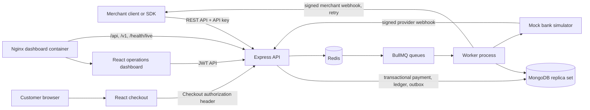
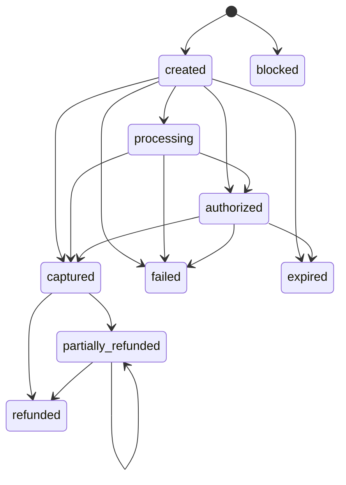

# PayOps — Payment Operations & Reliability Platform


PayOps is an educational payment operations and reliability platform. It demonstrates how payment systems can handle retries, asynchronous provider events, refunds, ledger entries, and webhook delivery. It is intended for developers learning backend payment workflows and for technical reviewers exploring reliability patterns.

**PayOps is intended as an educational simulation project.** The default `mockbank` provider is the intended demo provider and simulates outcomes. An optional Razorpay adapter also exists and calls Razorpay's live API endpoint; configuring it with live credentials can create real orders, capture payments, and issue refunds. The project validation did not verify live-account behavior. Use Razorpay test credentials for evaluation. Settlement and payout records remain ledger simulations and do not move money; the code does not technically prevent real-money transactions through a live Razorpay account.

## Implemented capabilities

- **Payment lifecycle:** explicit state transitions cover creation, processing, authorization, capture, failure, expiry, and refunds. Risk checks can also place a payment directly into the terminal `blocked` state. Invalid or backward transitions are rejected.
- **Idempotent API operations:** merchant payment requests accept `Idempotency-Key`; persisted idempotency records prevent duplicate creation and support replay. Refund amounts are reserved transactionally to limit concurrent over-refunds.
- **Simulated processing:** `mockbank` can produce success, failure, timeout, duplicate, and out-of-order event scenarios for exercising recovery behavior.
- **Refund operations:** refund work is queued, retried, and recorded. Ambiguous outcomes can be reviewed through restricted operator routes; this does not initiate a real transfer.
- **Double-entry ledger:** amounts are integer paise. Journal postings validate balanced debits and credits, and update account balances in the same MongoDB transaction. Integrity checks compare stored balances with journal-derived values.
- **Webhook outbox and delivery:** payment changes and outbox events are persisted together. MongoDB delivery records, BullMQ jobs, retry/backoff, stable job IDs, and periodic missing-job recovery support at-least-once delivery. Receivers should deduplicate by event ID.
- **Checkout capability security:** new browser checkout links put the capability in a URL fragment, then use an Authorization header for API requests. A legacy query-token fallback remains for existing clients during migration.
- **Operations dashboard:** the React UI provides payment, ledger, webhook, settlement, reconciliation, and key-management views, including bounded summaries and operational states.
- **Settlement and reconciliation simulations:** scheduled jobs create simulated settlement records and compare provider observations with internal records. Settlement allocation is limited; these functions do not provide complete settlement reconciliation.
- **Health and local deployment:** liveness/readiness endpoints, Docker Compose services, and dashboard Nginx routing support local development and isolated validation.

## Architecture



The API handles authentication, validation, synchronous state changes, and database transactions. MongoDB stores merchants, payments, attempts, refunds, ledger entries, provider events, outbox events, and webhook delivery records. MongoDB transactions require a replica set. Redis backs BullMQ and rate-limit state. Docker Compose runs API and worker containers separately; the current Render demo blueprint runs workers inside the API process. The dashboard container serves the Vite build with Nginx; Vercel configuration provides an alternate frontend deployment layout.

### Payment lifecycle



### Core workflows

1. **Payment creation and processing:** an authenticated merchant submits a payment. The API validates the request, persists the payment and idempotency result, and schedules provider simulation work. The mock provider reports outcomes through signed webhooks; the API applies permitted state transitions and posts ledger entries for captures.
2. **Idempotency:** a client supplies a stable idempotency key for a logical operation. The API persists the result under a unique key so retries can return the original operation instead of creating another payment. Reusing a key with a different payload is rejected.
3. **Refund:** a refund request reserves refundable value transactionally, then enters background processing. The simulated provider result updates the refund and payment lifecycle and creates balanced ledger postings. Retry exhaustion or ambiguous outcomes can require operator review.
4. **Ledger posting:** each posting consists of balanced debit and credit lines. Posting and account balance updates share a MongoDB transaction; the unique posting idempotency key prevents duplicate journal entries. Application-level guards reject ordinary journal mutation/deletion paths, but direct database access can bypass them.
5. **Webhook delivery and recovery:** transactional outbox events are relayed into durable delivery records and BullMQ jobs. Workers sign outgoing requests and retry failures. A periodic scan re-enqueues eligible deliveries missing active jobs; leases and idempotent handlers reduce duplicate work. Delivery remains at least once.
6. **Simulated settlement:** the worker periodically checks for eligible mature captured payments and writes simulated provider-settlement and payout ledger postings. The current balance-sweep model does not provide a complete payment-by-payment allocation explanation; see [Settlement allocation design](docs/SETTLEMENT_ALLOCATION_DESIGN.md).

## Technology stack

| Area | Technologies used |
|---|---|
| Frontend | React 18, React Router, Vite |
| Backend | Node.js 20+, Express, Mongoose, Zod, Pino |
| Database | MongoDB 7-compatible deployment; replica set required for transactions |
| Background processing | Redis 7-compatible service, BullMQ, separate Node worker in Compose |
| Infrastructure | Docker, Docker Compose, Nginx; Render Blueprint and Vercel configuration are included |
| Testing and tools | Jest, Docker Compose validation, npm audit, Node.js SDK |

## API overview

The API listens on port `4000` by default. Merchant API routes use `Authorization: Bearer <test-api-key>`; dashboard routes use a dashboard JWT. POST operations support idempotency where implemented. Amounts are integer paise.

| Method | Endpoint | Purpose / access |
|---|---|---|
| `GET` | `/health/live` | Public process liveness (`{ "ok": true }`) |
| `GET` | `/health/ready`, `/health` | Public MongoDB/Redis readiness; `/health` is a compatibility alias |
| `POST`, `GET` | `/v1/payments` | Create and list merchant payments; API key required |
| `GET` | `/v1/payments/:id` | Read a merchant payment; API key required |
| `POST`, `GET` | `/v1/payments/:id/refunds` | Create and list refunds for a payment; API key required |
| `GET` | `/v1/refunds/:id`, `/v1/balance` | Read a refund or ledger-derived balances; API key required |
| `POST`, `GET`, `DELETE` | `/v1/webhook_endpoints` and `/v1/webhook_endpoints/:id` | Manage merchant webhook endpoints; API key required |
| `POST` | `/webhooks/:provider` | Receive provider callbacks; provider-specific raw-body signature verification |
| `POST`, `GET` | `/api/dashboard/auth/register`, `/api/dashboard/auth/login` | Register or sign into a dashboard account |
| `GET`, `POST` | `/api/dashboard/payments` | List/create dashboard payments; JWT required |
| `GET` | `/api/dashboard/payments/:id` | Read a payment with attempts, refunds, journal entries, provider events, and webhook deliveries; JWT required |
| `POST` | `/api/dashboard/payments/:id/refunds` | Create a dashboard refund for a payment; JWT required |
| `GET` | `/api/dashboard/overview`, `/api/dashboard/me`, `/api/dashboard/ledger` | Dashboard summary, identity, and ledger; JWT required |
| `GET`, `POST`, `DELETE` | `/api/dashboard/webhooks...` | Inspect endpoints/deliveries and create, rotate, delete, or replay; JWT required |
| `GET`, `POST` | `/api/dashboard/settlements...`, `/api/dashboard/reconciliation...` | View or run simulations; manual platform-wide reconciliation requires allowlisted operator access |
| `GET`, `POST` | `/api/dashboard/refunds...`, `/api/dashboard/keys...` | Operator refund review and API-key management; operator actions are restricted |
| `GET`, `POST` | `/api/checkout/:id` and `/api/checkout/:id/confirm` | Read and confirm checkout using `Authorization: Checkout <capability>`; legacy query-token fallback remains |

Example simulated payment request:

```bash
curl http://localhost:4000/v1/payments \
  -H "Authorization: Bearer <test-api-key>" \
  -H "Idempotency-Key: order-1042" \
  -H "Content-Type: application/json" \
  -d '{"amount":49900,"description":"Order 1042","customer":{"email":"buyer@example.test"}}'
```

The response includes a payment object and checkout URL. Use only synthetic test values. See [SDK documentation](sdk/README.md) for the Node.js client and webhook signature helper.

## Local setup

### Prerequisites

- Docker Desktop or Docker Engine with Docker Compose (recommended); or Node.js 20+, MongoDB configured as a replica set, and Redis 7 for running services directly.
- Git.

### Start with Docker Compose

```bash
git clone https://github.com/Adityaraj-r/PayOps.git
cd PayOps
docker compose config --quiet
docker compose up --build
```

- Dashboard and hosted checkout: <http://localhost:5173>
- API: <http://localhost:4000>
- Liveness: <http://localhost:4000/health/live>
- Readiness: <http://localhost:4000/health/ready>

Compose initializes a local single-node MongoDB replica set and stores data in the named `onyx_mongo-data` volume. `docker compose down` preserves that data. `docker compose down -v` deletes the volume and its local database contents.

To populate a local demo account and synthetic activity, keep the Compose services running and use another terminal:

```bash
cd server
npm ci
npm run seed
```

The seed script creates synthetic records and is disabled when `NODE_ENV=production`. Do not use production credentials or data for demos.

### Run without Docker

Configure `server/.env` using the variable names and development defaults in [`server/.env.example`](server/.env.example). Provide a MongoDB replica-set URI and Redis URL, then run each process in a separate terminal:

```bash
cd server
npm ci
npm run dev
```

```bash
cd server
npm run dev:worker
```

```bash
cd client
npm ci
npm run dev
```

Vite serves the dashboard on port `5173` and proxies `/api` and `/v1` to `http://localhost:4000` by default. `VITE_PROXY_TARGET` can override that local development target. Do not commit `.env` files.

For current demo hosting configuration and manual Render/Vercel settings, see [Deployment guide](docs/DEPLOY.md). Hosted service availability is not verified by the repository validation.

## Testing and validation

Run the default backend tests and frontend production build:

```bash
cd server
npm ci
npm test -- --runInBand
cd ../client
npm ci
npm run build
```

The separate integration-enabled backend suite requires `PAYOPS_INTEGRATION=1`, a disposable MongoDB replica set, and disposable Redis. Never point integration tests at production data. Compose and deployment configuration can be checked with:

```bash
docker compose config --quiet
cd server
npm run check:deploy-config
```

Recorded verification in [the final validation report](docs/FINAL_VALIDATION_REPORT.md):

- **Default backend suite:** 18 suites passed, 1 skipped; 73 tests passed, 5 skipped.
- **Integration-enabled backend suite:** 19 suites and 78 tests passed with disposable MongoDB/Redis.
- **Frontend production build:** passed.
- **Docker Compose configuration and Nginx syntax:** passed.
- **Post-fix isolated routing:** `/health/live`, `/api/`, and `/v1/` returned HTTP 200; the dashboard healthcheck became healthy when the API dependency was available.
- **Dependency audit:** zero production backend vulnerabilities and zero frontend vulnerabilities were reported. The full backend development dependency audit reported six low-severity advisories in the Jest/deepmerge chain; no moderate/high findings were reported. No dependency changes were made.
- **Browser validation:** 11 frontend routes were reviewed in source, but 0 React routes were rendered in a browser. Browser visual, responsive, and browser E2E testing remain unverified.
- Neither package defines a lint script. A dedicated secret-scanning tool was unavailable during the recorded audit.

These results describe the recorded local and isolated checks, not a deployed production environment. See [testing results](docs/TESTING_RESULTS.md) for earlier stage-specific evidence and limitations.

## Known limitations

- `mockbank` is the intended demo provider. The optional Razorpay adapter calls Razorpay's live API endpoint; live credentials can enable real order creation, payment capture, and refunds. Live-account behavior has not been verified by project validation. Use test credentials for evaluation. The code does not technically prevent real-money transactions when configured with live credentials. Settlement and payout records are simulated and do not execute bank payouts.
- Settlement is a balance-sweep simulation with an allocation/traceability mismatch. It is not complete settlement reconciliation.
- Reconciliation compares provider records with internal records; it is not bank-statement reconciliation.
- Webhook delivery is at least once, so receivers must deduplicate. Queue durability depends on Redis persistence and hosting tier; recovery does not provide exactly-once delivery.
- Journal mutation protections operate at the application/Mongoose layer. Direct MongoDB/native-driver or administrator writes can bypass them; database-level append-only roles are not configured.
- Dashboard webhook views are bounded to the latest 100 delivery records; other dashboard summaries and ledger views are bounded as well.
- Legacy checkout query-token authentication remains during migration and can be exposed to infrastructure logging before the checkout page removes it.
- No approved retention periods or automatic archival/deletion policy is implemented for financial, audit, reconciliation, or webhook records.
- No browser-rendered UI, visual, viewport, keyboard, or browser E2E verification is claimed. A dedicated secret scanner and penetration test were not performed.
- The free Render blueprint is a demo topology. Free service restarts and non-persistent queue state are not suitable for reliable payment production.

## Roadmap — proposed work after the current MVP

These are ideas for future work, not implemented features or delivery commitments.

### Phase 1 — Reliability and observability

- Redesign settlement allocation so every amount is attributable to eligible payments, fees, refunds, and corrections; extend reconciliation coverage.
- Improve webhook delivery visibility for queue age, retries, exhausted attempts, and recovery outcomes.
- Add operational metrics and actionable monitoring/alerting around existing health and operations snapshots.

### Phase 2 — Security and testing

- Expand API and integration coverage for authorization boundaries and failure cases.
- Add browser-based end-to-end and responsive UI testing.
- Approve explicit retention periods and archival controls for audit, payment, reconciliation, and webhook records.
- Add a dedicated secret-scanning tool to automated validation and review its findings.

### Phase 3 — Scalability

- Improve queue recovery and dead-letter operations while preserving idempotent processing.
- Measure and tune worker concurrency and database/queue performance with repeatable load tests.
- Improve operational reporting without presenting bounded dashboard views as complete financial records.

## Project history, ownership, and acknowledgements

The current Git history was rewritten to an aggregate snapshot, so its root commit does not prove authorship of inherited code. The provenance audit distinguishes inherited foundations from specific later changes and documents the available commit evidence. Aditya-attributed changes include Stage 3 checkout capability handling, request-log redaction, webhook recovery/leases, Docker routing, seed safeguards and regression tests; Stage 4 Mongoose-level journal mutation safeguards and related tests; and later dashboard presentation and documentation work. These contributions do not establish sole authorship of the payment platform. See [ownership and provenance audit](docs/OWNERSHIP_AUDIT.md).

The project acknowledges patterns studied from [payment-reliability-engine](https://github.com/anirbanshit29/payment-reliability-engine) and [payflux](https://github.com/MOHITU778/payflux). The prior audit found no vendored source, but did not independently establish derivation or license compatibility. Preserve applicable notices and acknowledgements. Runtime and development libraries listed in the package manifests are third-party dependencies.

## Resources

- [PayOps GitHub repository](https://github.com/Adityaraj-r/PayOps)
- [Deployment guide](docs/DEPLOY.md)
- [Architecture audit](docs/ARCHITECTURE_AUDIT.md)
- [Security audit](docs/SECURITY_AUDIT.md)
- [Final validation report](docs/FINAL_VALIDATION_REPORT.md)
- [Node.js SDK](sdk/README.md)
- [MIT License](LICENSE)

PayOps is a technical learning project for studying payment lifecycle and reliability patterns in a controlled simulation. Treat all payment, refund, settlement, and payout behavior as synthetic.
