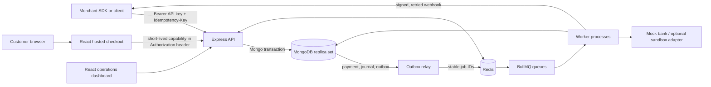

# PayOps interview guide

PayOps is an educational payment operations and reliability simulation. It is not a real-money processor, and its settlement records do not transfer money. This guide describes the repository at the Module 3 verification baseline (`e2c30a8`). Read the linked code before presenting a claim; the audit documents distinguish inherited code from later changes.

## 60-second introduction

“I’ve been working on PayOps, an educational payment operations platform that simulates the failure modes around payment APIs. A merchant can create a payment with an idempotency key, a customer can complete a hosted checkout, and a mock bank can send duplicate, delayed, reordered, failed, or missing events. The backend uses MongoDB transactions for payment state, double-entry ledger postings, and a transactional outbox; BullMQ workers use Redis to process provider events, refunds, and merchant webhooks. I focused on hardening checkout capability handling, recovering webhook jobs lost from Redis, preventing duplicate delivery work, protecting ledger entries through application write paths, and improving the dashboard’s operational explanations. I also documented the limits: the ledger immutability protection is not database-admin proof, webhook delivery is at least once, and settlements still sweep balances without explicit allocation. This is a simulation, not a system that moves customer funds.”

## Architecture

MongoDB is the durable record for payments, journal entries, provider events, webhook events/deliveries, and related operational records. Transactions require a replica set. Redis stores BullMQ job state and supports rate limiting/idempotency response caching; it is not the durable source of truth for outbox deliveries. Docker Compose starts separate API and worker services. The Render demo blueprint sets `RUN_WORKERS_IN_API=true` on its single web service. The dashboard uses Nginx in Docker and Vercel rewrites in the documented hosted configuration.

## Payment lifecycle

1. A merchant submits `POST /v1/payments` with a bearer API key, a request body, and `Idempotency-Key`.
2. Middleware fingerprints method, path, and body, atomically claims the `(merchant, key)` record, and either runs the request, replays its saved response, rejects an in-progress duplicate, or rejects a key reused with a different request.
3. The API creates a `created` payment and a checkout URL. The checkout capability is in the URL fragment, which browsers do not send in the HTTP request. The supported page reads it and sends it in an Authorization header. Legacy direct API query-token compatibility remains during migration.
4. Checkout confirmation queues provider work. The mock bank can capture/fail, send duplicate or reordered events, or remain silent. A polling task can recover payments whose callback does not arrive. Provider signatures are checked over the raw request bytes; provider event IDs are unique.
5. A successful capture changes payment state, posts balanced ledger lines, updates account totals, and creates an outbox event in a MongoDB transaction. The illustrative capture is: debit provider receivable by gross amount; credit merchant payable by gross less fee; credit fee revenue by fee.
6. The outbox relay creates durable delivery records and queues work. Workers lease deliveries, sign requests, retry with backoff, and mark terminal failures for operator replay. A periodic recovery scan compares pending MongoDB deliveries with active queue jobs and re-enqueues missing jobs using stable delivery IDs.
7. Refunds reserve refundable value conditionally before asynchronous provider work. Duplicate requests are idempotent; concurrent requests cannot reserve more than the captured amount. In the demo, the provider is simulated.

## Core design choices and limits

### Idempotency and state

MongoDB's unique idempotency record and conditional state updates coordinate requests across API instances. Redis provides a faster cached response; MongoDB remains the source of truth. Stale in-progress records can be claimed after their lock expires. Payment transitions are checked against an explicit state machine and use versioned conditional updates.

### Ledger

Amounts are integer paise. Each journal entry is checked for balanced debit and credit lines and uses a unique posting key to avoid duplicate capture/refund postings. Payment, entry, balances, and related outbox data are committed transactionally. Mongoose middleware blocks ordinary application update/delete paths for posted journal entries. Direct native MongoDB/admin access can bypass it, so database-role enforcement is a known gap. Corrections should use reversal/adjustment entries, not edits.

### Webhook delivery

MongoDB outbox and delivery records let the app rebuild queue work after Redis job loss. Stable job IDs and a MongoDB lease reduce concurrent claims; they cannot provide exactly-once network delivery. If a receiver accepted the HTTP request just before a worker crashed, it may be sent again. Consumers should verify HMAC/timestamp and deduplicate by event ID. Queue reliability also depends on the Redis service's persistence and eviction policy.

### Checkout capability

New browser links place the secret in the fragment and exchange it through an Authorization header. Logs redact authorization/cookie values and Nginx access logging records the URI path without query values. The API still accepts the older query-token flow for a migration period, so legacy clients and infrastructure that logs query strings remain a residual exposure path. Browser history and referrer handling are tightened in the supported page; do not claim every upstream proxy or error reporter is controlled by this repository.

### Settlement and reconciliation

The current settlement simulator sweeps ledger account balances when an eligible mature payment exists, but the settlement record links only eligible mature payments. Therefore some swept value may not be explainable through those linked payments. This allocation defect is documented and intentionally not implemented pending business-policy approval. Reconciliation compares provider observations to application records; there is no bank statement feed or proof of money movement. No retention cleanup is enabled; periods need policy approval.

## Interview questions and answers

1. **What does PayOps solve?** It is a learning environment for retries, duplicate/out-of-order events, refunds, ledger postings, and queue recovery—not a payment processor.
2. **Why use an idempotency key?** A client may not know whether a timed-out request committed. Reusing the key returns the prior result instead of creating a second payment.
3. **How do you prevent two first requests racing?** A unique MongoDB index atomically claims the merchant/key pair; check-then-act would race.
4. **What is the request fingerprint for?** It binds a key to method, path, and body so a different operation cannot reuse the same key silently.
5. **Why persist before responding?** A fast retry should find the completed response, not observe a successful operation as still in progress.
6. **Why Redis and MongoDB for idempotency?** Redis caches responses; MongoDB is the authoritative record and survives cache loss.
7. **What happens after an API crash mid-request?** The record remains in progress; after its lock becomes stale, one retry can conditionally claim it and resume.
8. **Why integer paise?** Integer minor units avoid binary floating point errors in financial arithmetic.
9. **How does a capture balance?** Gross provider receivable is debited; merchant payable net of fee and fee revenue are credited. Debit equals credit.
10. **How are duplicate capture postings prevented?** A stable posting idempotency key plus a unique database constraint prevents the same payment from posting twice.
11. **Why MongoDB transactions?** Payment state, journal, balance totals, and outbox event must commit or abort together; this requires replica-set transactions.
12. **What is the outbox pattern?** The business transaction stores the event with the state change. A relay publishes it later, closing the crash gap between database commit and queue enqueue.
13. **What if Redis loses a webhook job?** A periodic scanner finds durable pending deliveries without active jobs and re-enqueues them using a stable delivery ID.
14. **Does that make webhooks exactly once?** No. It provides at-least-once delivery. A crash after receiver acceptance but before local success persistence can cause a duplicate.
15. **How do you avoid two workers processing one delivery?** A conditional MongoDB lease controls the claim and expiration enables recovery after worker death.
16. **How are provider events authenticated?** The route captures raw bytes and verifies HMAC before parsing/processing; event IDs are unique for duplicate detection.
17. **What happens when events arrive out of order?** The payment state machine rejects transitions that would move a terminal or later state backward; provider events are recorded with processing outcome.
18. **How are refunds protected from concurrency?** An atomic conditional reservation checks captured amount against already-refunded, pending, and new amount before queuing provider work.
19. **How is a failed or ambiguous refund handled?** Retries are attempted; exhaustion releases reservation or marks attention for an operator/provider status check, depending on whether outcome is known.
20. **Are ledger rows immutable?** Ordinary Mongoose update/delete paths are blocked and tested. Native database access can bypass this; no database append-only role is provisioned here.
21. **What is the checkout token migration?** New browser links use URL fragments and send the capability in Authorization. Query fallback remains for direct legacy clients; removal needs consumer inventory and a sunset period.
22. **What does the settlement screen prove?** Only that the simulator created an accounting record. The allocation bug means swept value is not fully attributable to linked payments, and it never proves a bank transfer.
23. **What does reconciliation compare?** Application payment/provider observations and ledger state. There is no bank statement integration.
24. **What happens when Redis is unavailable?** Production rate limiting fails closed; queue work cannot progress until Redis returns, while durable MongoDB delivery records permit later recovery.
25. **What limits horizontal scaling?** The API is stateless, but MongoDB transaction contention, a polling outbox relay, shared Redis queues, and noisy-merchant queue contention need monitoring and eventual partitioning.
26. **How are demo seed routes protected?** Seed logic refuses production mode; production dev routes are disabled by the Render blueprint. These safeguards are covered by tests/config validation.
27. **What did your changes contribute?** Point to the specific Aditya-authored hardening commits and Module 2 dashboard commit in `OWNERSHIP_AUDIT.md`; distinguish them from inherited baseline functionality.
28. **What would you improve next?** Obtain policy approval and implement explicit settlement allocation with invariants; configure a least-privilege database role for journal immutability; approve retention periods; then test these changes in isolated environments.

## 5–7 minute demo sequence

Use a local disposable demo database. Do not use live provider credentials or real customer information.

| Time | Action | What to explain |
|---|---|---|
| 0:00–0:45 | Open the dashboard and point out the simulation label and overview cards. | Data comes from existing API resources; activity summaries have bounded windows/record limits. |
| 0:45–1:45 | Create a payment in the developer/API flow and open its checkout link. | Show the `created` state, idempotency key, and capability sent in an Authorization header; do not copy the secret into screenshots. |
| 1:45–2:45 | Complete a mockbank success checkout. | Trace captured state, integer-paise fee, and balanced debit/credit lines. |
| 2:45–3:30 | Repeat the same API request with the same idempotency key. | Explain saved-response replay and why the unique claim is needed under concurrent retries. |
| 3:30–4:30 | Open webhook delivery detail or configure the local sink, then show delivery status/attempt metadata. | Explain HMAC, retries, stable job IDs, durable MongoDB state, and at-least-once semantics. |
| 4:30–5:20 | Submit a partial simulated refund from payment detail. | Explain atomic reservation and why two concurrent refunds cannot exceed captured value. |
| 5:20–6:10 | Visit settlement and reconciliation. | State the allocation mismatch and that neither page proves money moved or complete bank reconciliation. |
| 6:10–6:45 | Close with known risks and evidence. | Mention database-admin bypass for immutability, legacy query compatibility, Redis tier dependency, retention policy, and exact tests in `TESTING_RESULTS.md`. |

Demo labels or UI may change; rehearse against a fresh local seed and avoid claiming steps that were not exercised in the current build.

## Verified resume bullets

- Implemented MongoDB-backed webhook delivery recovery that detects missing BullMQ jobs and uses stable job IDs and expiring leases to reduce duplicate processing; verified with recovery/retry tests.
- Hardened browser checkout capability handling by using URL fragments and Authorization headers, redacting sensitive request headers, adding expiry checks, and retaining a documented legacy query migration path.
- Added application-level protections and regression tests against mutation/deletion of posted ledger entries, while documenting the native database privilege boundary.
- Improved the React operations dashboard with bounded activity summaries, clearer simulation states, loading feedback, refund/replay confirmations, and responsive navigation using existing APIs.

These bullets describe verified diffs only. Do not claim authorship of the inherited payment platform, exactly-once webhooks, database-enforced ledger immutability, complete settlement allocation, or real payment processing. For commit evidence and third-party acknowledgements, see [`OWNERSHIP_AUDIT.md`](OWNERSHIP_AUDIT.md).
